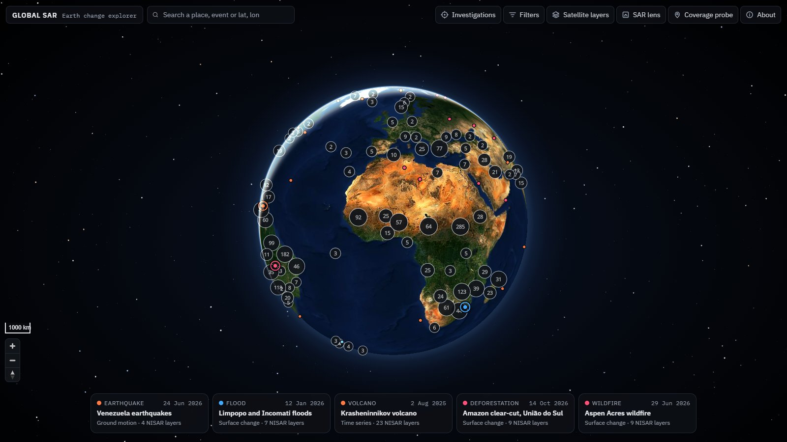
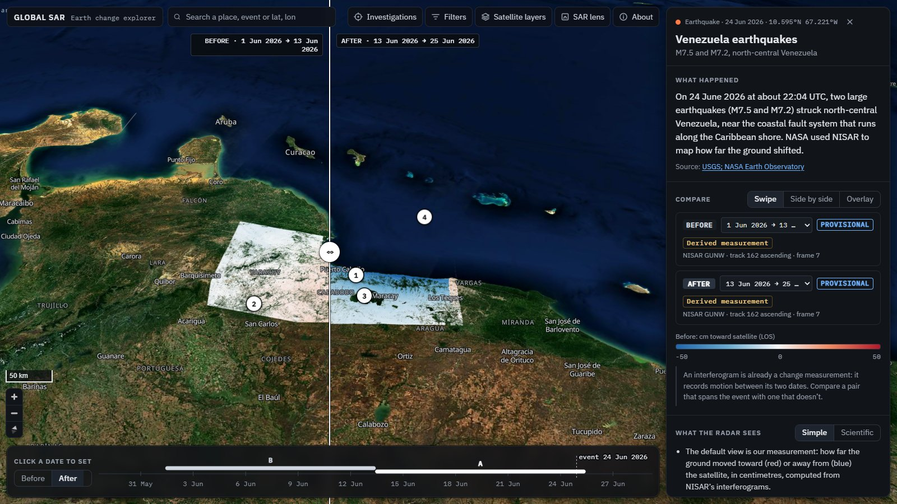
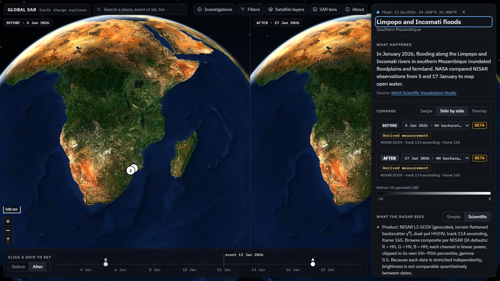
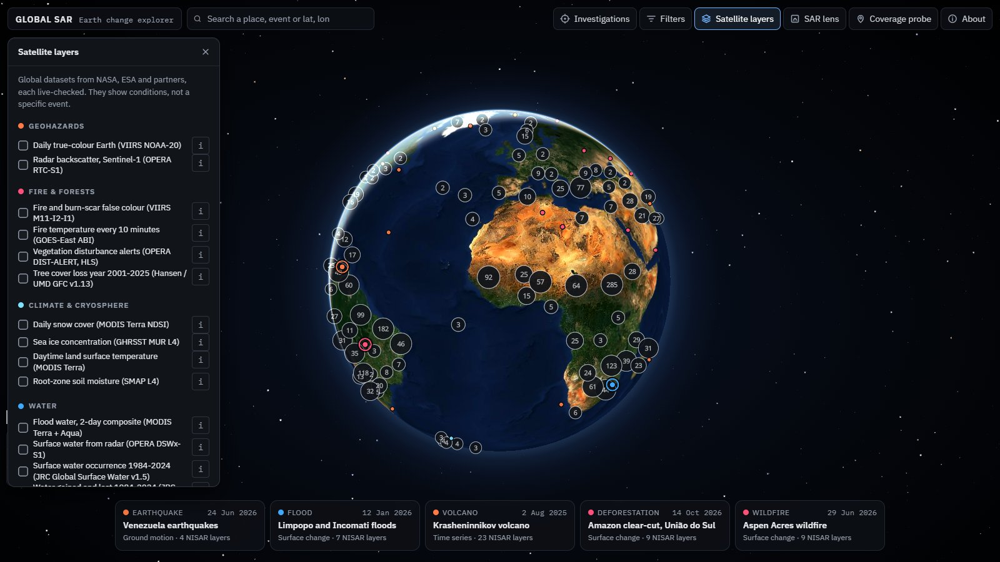
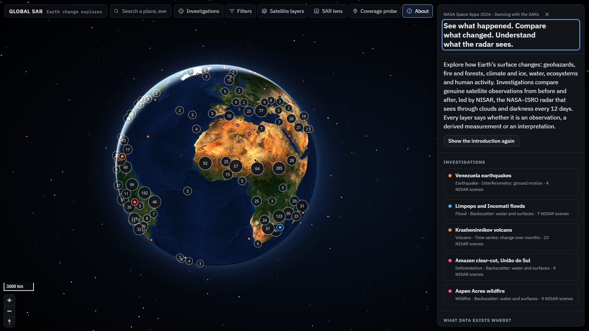
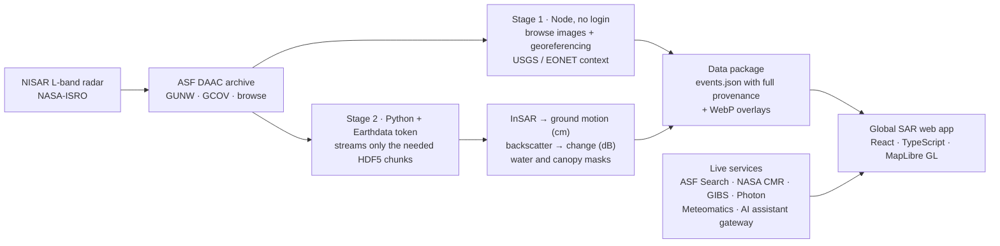

<div align="center">

# Guardians of the Cosmos: Global SAR

### See what happened. Compare what changed. Understand what the radar sees.

**A map-first 3D globe that turns real NASA-ISRO NISAR radar data into evidence anyone can read.**

[](https://globalsar.earth)
[](https://www.spaceappschallenge.org)
[](https://www.spaceappschallenge.org)


**[Open the live demo](https://globalsar.earth)** · [Screenshots](#screenshots) · [Results](#results-on-real-nisar-data) · [How it works](#how-it-works) · [Run it locally](#run-it-locally)



</div>

---

## Summary

| | |
| --- | --- |
| **Problem** | Radar satellites see Earth through clouds and darkness, but their images look like grey noise to students, the public and many decision-makers. The data sits in large HDF5 files behind logins. |
| **Solution** | **Global SAR**, a photoreal 3D globe. Select an earthquake, flood, fire or volcano, compare *before* and *after* radar images, read a plain-language explanation in real units, and ask the AI assistant about what you see. |
| **Evidence** | Five investigations on genuine NISAR data: 45 cm of earthquake ground motion, 322–379 km² of new flood water, 35.7 km² of cleared forest, 68 km² of burned canopy and an 11-date volcano time series. |
| **Trust** | Every layer records its mission, product, data tier, track, frame, dates and processing steps. NASA imagery is labelled *NASA browse*; our computations are labelled *derived by team*. Nothing is simulated. |
| **Quality** | 1,071 automated tests (789 web, 196 Python, 59 pipeline JS, 27 gateway), accessibility checks and 0 known dependency vulnerabilities. |

---

## Why it matters

NASA and ISRO's **NISAR** mission is one of the most capable Earth-observing radar satellites in orbit. Its L-band signal passes through clouds, smoke and darkness, penetrates tree canopies and measures ground motion of a few centimetres. That makes it well suited to floods under storm clouds, earthquakes, wildfires and deforestation.

That value is lost if people cannot read the data. Global SAR is designed so that **a first-time user can say what changed in each investigation within one minute, with no prior radar knowledge.**

### Target users

| User | Need | What Global SAR provides |
| --- | --- | --- |
| **Students and the public** | Understand what a disaster did to the ground | Select an event, compare before and after, read the *Simple* explanation |
| **Teachers and science communicators** | Ready, trustworthy radar examples | Five curated investigations with sources, units and stated limits |
| **Researchers and analysts** | Find which NISAR data exists for a place and date | Live coverage probe for any point on Earth and *Scientific* explanations |

---

## Screenshots

**Before / after comparison.** Venezuela earthquakes, 24 June 2026: a swipe between NISAR interferograms from before and across the event, with provenance, data tier and a colour scale in centimetres.



**Side-by-side view with the Scientific explanation.** Limpopo and Incomati floods, January 2026: NISAR GCOV backscatter from 5 and 17 January, with the product description and processing notes.



<table>
<tr>
<td width="50%"><b>Satellite layers.</b> Global NASA, ESA and partner datasets grouped by theme, each with a legend and an information panel.<br><br></td>
<td width="50%"><b>About and investigations.</b> The project's purpose, the five NISAR investigations and what data exists where.<br><br></td>
</tr>
</table>

---

## Features

- **Photoreal 3D globe** with Sentinel-2 cloudless imagery, terrain, atmosphere and fly-to navigation.
- **Close-up photo imagery.** Zoom in and Esri World Imagery fades in over Sentinel-2, sharp enough to read building details in cities. Where Esri has no photos the grey "no data" tiles are detected and hidden, so the 10 m Sentinel-2 view stays underneath. The closest zoom is capped so the scale bar never reads below 50 m, at any latitude.
- **Guided first visit.** A front page explains each tool step by step with real screenshots, and an interactive tutorial has the visitor use each tool. The About panel has a way back to the front page.
- **Language switch (EN / TR)** with a full Turkish translation, and Turkey labelled as Türkiye.
- **Lite mode** for weak or software-only GPUs (`?lite=1`, chosen automatically on a software renderer): no terrain, halo or sky shading, pixel ratio 1 and smaller images, about 3x faster where the GPU is slow.
- **Five NISAR investigations** (earthquake, flood, volcano, deforestation, wildfire), all on real radar data.
- **Before / after comparison** in swipe, side-by-side and overlay modes, with a timeline of radar passes and shareable URLs.
- **Two explanation levels**, *Simple* and *Scientific*, with numbered annotation pins and legends in physical units (cm, dB).
- **AI assistant** ("Ask") that runs in the visitor's browser, answers only from a checked knowledge base and the investigation on screen, and cites what it used. It understands differently-worded questions in English and Turkish (paraphrases, synonyms, typo fixing) and declines off-topic ones; this is measured on a held-out stress set with a unit test.
- **Weather data** from Meteomatics for the selected location and date.
- **SAR lens** to view any area through recent NISAR and Sentinel-1 radar.
- **Live NISAR coverage probe**: select any point to list the real NISAR acquisitions over it (ASF Search API).
- **NASA Earthdata search** (CMR) for other NASA datasets available at a location.
- **Global satellite layers** (NASA GIBS, UMD, JRC, EOX, ESA WorldCereal farmland and crop types) with per-layer dates and colour legends.
- **Event catalogs for context**: about 170 recent USGS (M6.3+) and NASA EONET events, plus tsunamis, eruptions, FIRMS fires, landslides and flood alerts, with a six-group taxonomy and filters. No SAR analysis is claimed for catalog events.
- **Evidence badges** (observation, derived, interpretation, model, simulation) on every layer.
- **Installable web app (PWA)** with a dedicated mobile layout.

---

## Results on real NISAR data

All results are **derived by the team** from genuine NISAR products distributed by the ASF DAAC. They are heuristic and not field-validated; see [Limitations](#limitations).

| Investigation | Technique | NISAR data | Result | Independent check |
| --- | --- | --- | --- | --- |
| **Venezuela earthquakes**, 24 Jun 2026 | Interferometry (GUNW) | Track 162A, frame 007; 1→13 Jun (pre-event) vs 13→25 Jun; PROVISIONAL | Up to **~45 cm** line-of-sight motion away from the satellite along the coast | Pre-event pair noise **3.5 cm** (std); pattern consistent with NASA's published analysis |
| **Limpopo floods**, Mozambique, Jan 2026 | Backscatter change (GCOV HH/HV) | Track 114A, frame 165; 24 Dec, 5 Jan, 17 Jan; BETA | **322–379 km²** of new water around Chókwè, in a 3,370 km² study area | Range from two speckle filters; a scene-wide +3.07 dB brightening is removed first |
| **União do Sul clear-cut**, Mato Grosso, Oct 2026 | HV canopy change (GCOV) | Track 002A, frame 172; 4 dates, 18 Sep – 24 Oct | **35.7 km²** strong HV loss | **68 %** of the official INPE DETER alert box shows loss, vs 11 % of the wider area |
| **Aspen Acres fire**, Colorado, Jun 2026 | HV canopy change (GCOV) | Track 019A, frame 021; 4 dates, 15 Jun – 14 Aug | **68 km²** woody canopy loss | Reported fire size 372 km²; L-band HV detects tree loss, not grass and shrub burn |
| **Krasheninnikov volcano**, 2026 | Backscatter time series (GCOV) | Track 060D, frame 061; 11 dates, 18 Jun – 28 Oct | 12 full-resolution HH/HV layers on one fixed calibrated stretch | Qualitative only; no quantitative claim |

---

## How it works



1. **Collect.** The pipeline retrieves NISAR products from NASA's ASF DAAC. Stage 1 requires no login: it downloads NASA's official browse images and georeferences them by fitting each image's data corners to the ASF footprint, recording the residual per layer (about 25–650 m).
2. **Process.** Stage 2 streams only the HDF5 chunks it needs over HTTPS, with retries for unreliable networks, and computes quantitative layers (see [Methods](#methods)).
3. **Explore.** The web app reads one static data package (`events.json` plus WebP overlays) and calls public services live. The assistant runs behind a contract-tested gateway that only answers from the context it is given.

---

## Methods

<details>
<summary><b>InSAR ground motion (GUNW)</b></summary>

- Line-of-sight displacement **d = −φλ / 4π**, with λ taken from the product's `centerFrequency`.
- The ionosphere phase screen is subtracted; pixels with coherence < 0.3 or outside connected components are masked.
- Displacement is referenced to a far-field box; both pairs share one colour scale.
- The noise floor comes from the pre-event pair: **3.5 cm** standard deviation for Venezuela.
</details>

<details>
<summary><b>Flood mapping (GCOV HH)</b></summary>

- The threshold is the centre of the histogram valley, with bimodality checked per date. For Limpopo the 5 January histogram is not bimodal, so both dates use the 17 January threshold (−14.75 dB); the provenance record states this.
- **New water** = water-like after, not water-like before, and darkened by more than 3 dB relative to the scene-wide median change, which removes calibration and soil-moisture offsets between dates.
- Area is reported as a range from two speckle filters: a 3×3 median (estimate) and a 5×5 boxcar (lower bound).
</details>

<details>
<summary><b>Forest and fire loss (GCOV HV)</b></summary>

- HV log-ratio on a 3×3 median; the scene-wide median change is removed first; strong loss is below −3 dB.
- Volume scattering collapses when canopy is removed or burned.
- Where an independent reference exists (INPE DETER), the loss fraction inside its box is reported next to the area-wide fraction.
</details>

<details>
<summary><b>Time series and browse imagery</b></summary>

- Volcano time series: an HH/HV composite on one fixed calibrated stretch for all dates, so colours are comparable across dates.
- NASA browse renderings are georeferenced from footprint corners with a stated positional uncertainty of about 1–1.4 km. They are labelled as visualizations and never used for measurement.
</details>

### Scientific integrity

- Every layer records mission, product, data tier, CRID, track, frame, acquisition times, granule ID and each processing step.
- NASA imagery is labelled *NASA browse*; our computations are labelled *derived by team*.
- Known limitations are shown in the app next to the result they affect.
- No simulated or predicted layers. Earthquake and eruption prediction is out of scope by design.

---

## Limitations

- **Line of sight only.** InSAR measures motion along the satellite's viewing direction; tropospheric delay is not corrected.
- **Early calibration.** Early-2026 NISAR products are BETA (CRID X05010); several investigations use BETA or mixed PROVISIONAL/VALIDATED data, flagged in each provenance record.
- **Estimates.** Flood and canopy areas are heuristic and not field-validated, so they are reported as ranges where possible.
- **Not official.** Results are the team's own derived analysis, not official NASA products.
- **Coverage gaps.** No public NISAR products were found for 27 July – 10 August 2026.

---

## Tech stack

| Layer | Technology |
| --- | --- |
| Front end | React 19, TypeScript 7, Vite 8 |
| Map | MapLibre GL 6 (3D globe, terrain, atmosphere) |
| Data pipeline | Node.js (ASF search, browse images, catalogs); Python (h5py + fsspec HDF5 streaming, NumPy, SciPy, scikit-image, rasterio, pyproj) |
| AI assistant | Node gateway with a JSON-schema contract shared by app, gateway and model; CORS, size and rate limits |
| Testing | Vitest, fast-check (property and fuzz tests), Testing Library, Playwright, axe-core, pytest, Hypothesis |
| Hosting | GitHub Pages via GitHub Actions, custom domain **globalsar.earth** (HTTPS) |

---

## Run it locally

**Requirements:** [Node.js](https://nodejs.org) 20.19 or newer (22 recommended) and git. The data package is included in the repository, so the core app needs no API keys.

```bash
git clone https://github.com/Denizprof/Guardians-of-the-cosmos.git
```
```bash
cd Guardians-of-the-cosmos
```
```bash
npm run setup
```
```bash
npm start
```

Then open **http://localhost:4173**.

| Command (repository root) | Description |
| --- | --- |
| `npm run setup` | Installs the web app's dependencies (once) |
| `npm start` | Builds and serves the app at http://localhost:4173 |
| `npm run dev` | Development server with live reload at http://localhost:5173 |
| `npm test` | Runs the web unit tests |

<details>
<summary><b>Weather and AI assistant configuration</b></summary>

- **Weather:** copy `web/env.example` to `web/.env.local`, add your Meteomatics username and password, and restart. See [docs/meteomatics.md](docs/meteomatics.md).
- **AI assistant, in the browser (default):** nothing to configure. To offer the fine-tuned model, set `VITE_ASSISTANT_MODEL` to its Hugging Face repository; see [assistant-model/README.md](assistant-model/README.md).
- **AI assistant, your own model:** start the gateway with your model endpoint (`cd assistant-gateway && ASSISTANT_MODEL_URL=<your endpoint> npm start`) and set `VITE_ASSISTANT_GATEWAY_URL=/` in `web/.env.local`. See [docs/assistant-integration.md](docs/assistant-integration.md) and the contract in `shared/assistant-contract/`.
</details>

<details>
<summary><b>Windows</b></summary>

- Double-click `start-windows.cmd` after cloning. It installs dependencies on the first run, then builds and starts the app.
- If PowerShell reports that running scripts is disabled, use `npm.cmd run setup` and `npm.cmd start`, or run the commands in Command Prompt.
- Clone into a short path such as `C:\dev`, not `C:\Windows\System32`; short paths also avoid Windows path-length limits.
</details>

<details>
<summary><b>macOS</b></summary>

- Install Node.js from [nodejs.org](https://nodejs.org) or with Homebrew (`brew install node`), and accept the command line tools prompt the first time you run `git`.
- Alternatively, double-click `start-mac.command`. If macOS blocks it, right-click and choose **Open**, or run `./start-mac.command` in Terminal.
</details>

<details>
<summary><b>Install as an app</b></summary>

Open the app in Chrome or Edge and choose **Install Global SAR** from the address bar or browser menu. On a phone, use **Add to Home screen**. An internet connection is still required, because map imagery loads live.
</details>

---

## Rebuild the data

```bash
cd pipeline && npm install
node src/fetch-browse.mjs && node src/fetch-context.mjs && node src/fetch-catalogs.mjs
pip install -r python/requirements.txt
python python/process.py
```

`python/process.py` requires a free **NASA Earthdata Login** token. Create one at https://urs.earthdata.nasa.gov/user_tokens and set it as the `EARTHDATA_TOKEN` environment variable. Never commit it. On Windows, keep the repository at a short path such as `C:\dev\...`.

---

## Quality and testing

| Suite | Command | Result |
| --- | --- | --- |
| Web unit, property and fuzz tests (Vitest, fast-check) | `cd web && npm test` | **789 / 789** pass |
| End-to-end and accessibility (Playwright, axe-core) | `cd web && npm run test:e2e` | Desktop, mobile (375×812), keyboard, resilience and visual suites |
| Pipeline JS (node:test, fast-check) | `cd pipeline && npm test` | **59** pass, 2 pending |
| Pipeline Python (pytest, Hypothesis) | `cd pipeline && python -m pytest` | **196 / 196** pass |
| Assistant gateway (node:test) | `cd assistant-gateway && npm test` | **27 / 27** pass |
| Type check and production build | `cd web && npm run build` | Pass |
| Dependency audit | `npm audit --omit=dev` | **0** vulnerabilities |

A QA audit identified 23 issues; 19 are fixed with regression tests. See [docs/qa/](docs/qa/) and [docs/final-report.md](docs/final-report.md).

---

## Repository layout

```text
Guardians-of-the-cosmos/
├── web/                        # Web app: React + Vite + TypeScript + MapLibre GL
│   ├── src/                    # Components, map, assistant UI, explanations, services
│   ├── public/data/            # Data package: events.json (with provenance), layers.json, overlays
│   └── tests/                  # Unit, property/fuzz, e2e, accessibility, visual and performance tests
├── pipeline/                   # Offline data pipeline
│   ├── src/*.mjs               # Node: ASF search, browse images, georeferencing, catalogs
│   ├── python/                 # Python: quantitative layers from NISAR HDF5
│   └── tests/                  # node:test and pytest suites with recorded fixtures
├── assistant-gateway/          # AI assistant gateway (contract-tested)
├── shared/assistant-contract/  # JSON schemas shared by app, gateway and model
├── docs/                       # Design brief, data sources, final report, QA, research, screenshots
├── .github/workflows/          # GitHub Pages deployment
├── start-windows.cmd           # One-click start on Windows
└── start-mac.command           # One-click start on macOS
```

---

## Documentation

| Document | Contents |
| --- | --- |
| [docs/design-brief.md](docs/design-brief.md) | Challenge, problem, users, goals and design principles |
| [docs/final-report.md](docs/final-report.md) | Feature inventory, methods, results, tests and known limitations |
| [docs/data-sources.md](docs/data-sources.md) | Every dataset and API used, with licences |
| [docs/assistant-integration.md](docs/assistant-integration.md) | AI assistant integration and contract |
| [assistant-model/README.md](assistant-model/README.md) | The in-browser chatbot: knowledge base, training, measured results, browser export |
| [docs/meteomatics.md](docs/meteomatics.md) | Weather data configuration |
| [docs/qa/](docs/qa/) | QA issues, code review and test report |

---

## Team

**Guardians of the Cosmos**: Azra, Ece, Berk, Daniel, Efe and Arte.

Built for the **NASA Space Apps Challenge 2026**, challenge *Dancing with the SARs*.

---

## Credits and data sources

- **NISAR data:** NASA/JPL-Caltech and ISRO, distributed by the [ASF DAAC](https://nisar-docs.asf.alaska.edu/).
- **Event context:** USGS, NASA EONET, NOAA NCEI, NASA FIRMS, NASA GLC, GDACS.
- **Satellite layers:** NASA GIBS, University of Maryland, JRC, EOX.
- **Weather data:** Meteomatics.
- **Globe imagery:** Sentinel-2 cloudless 2024 by EOX IT Services GmbH (contains modified Copernicus Sentinel data 2024), CC BY-NC-SA 4.0.
- **Close-up imagery:** Esri World Imagery (Esri, Maxar, Earthstar Geographics and the GIS User Community), shown when zoomed in.
- **Terrain:** Mapzen / AWS Terrain Tiles. **Labels:** © OpenStreetMap contributors, OpenFreeMap, OpenMapTiles. **Geocoding:** Photon.
- **NASA resources:** [Space Apps Challenge](https://www.spaceappschallenge.org) · [NISAR documentation](https://nisar-docs.asf.alaska.edu/) · [Earthdata](https://www.earthdata.nasa.gov)

---

## License

The code in this repository is released under the [MIT License](LICENSE).

Third-party data and imagery keep their own licences, listed under Credits. For example, the Sentinel-2 cloudless imagery by EOX is CC BY-NC-SA 4.0 and may not be used commercially. Esri World Imagery is used under Esri's terms with attribution; a commercial deployment needs its own Esri agreement.

<div align="center">

**[Explore Earth's changes at globalsar.earth](https://globalsar.earth)**

</div>
